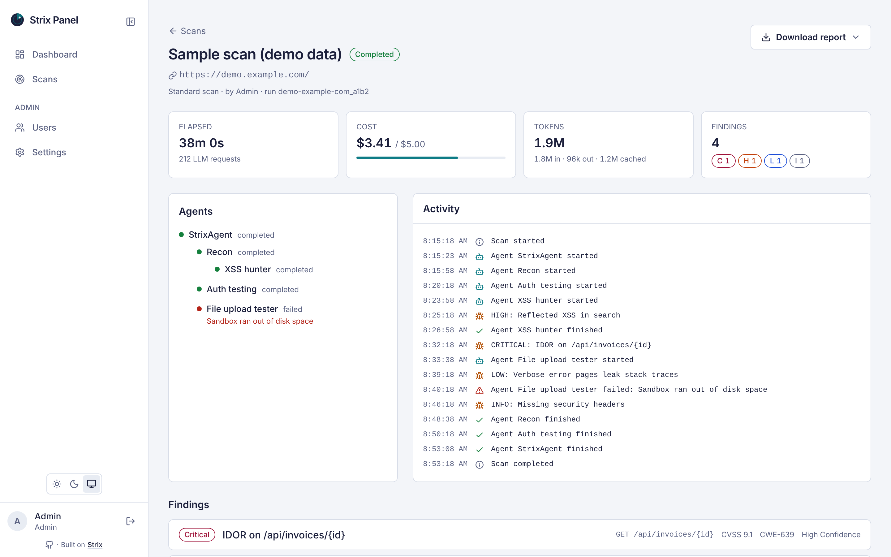
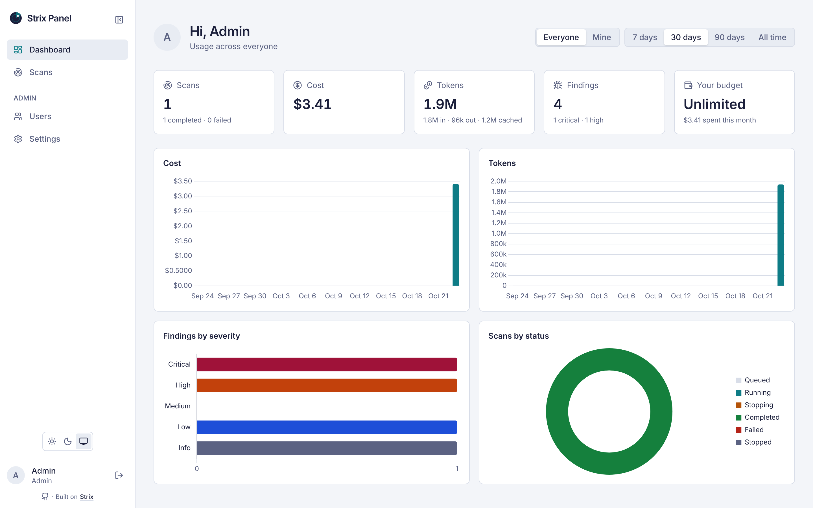

# Strix Panel

**Run AI pentests from your browser.** Strix Panel is a self-hosted web app for [Strix](https://strix.ai), the open-source AI penetration-testing agent. Strix itself is a command-line tool. Strix Panel gives your team a place to start scans, watch them work in real time, read the findings and keep an eye on what the LLM costs.

<picture>
  <source media="(prefers-color-scheme: dark)" srcset="docs/screenshots/scan-dark.png">
  
</picture>

## What you get

- 🚀 **Start a scan in a few clicks.** Point Strix at up to 3 targets (`http(s)` URLs or uploaded OpenAPI/Postman files; admins can raise the limit to 20). Add a name, extra instructions for the agent and a USD budget cap if you like.
- 👀 **Watch it live.** Status, agents, an activity feed and token and cost usage update in your browser as the scan runs. Stop a scan whenever you want, and resume one that stopped or failed.
- 🐞 **Read the findings.** Vulnerabilities sorted by severity, each with its full write-up. Download the report as Markdown or PDF.
- 📊 **See the big picture.** A dashboard with runs, tokens, cost and findings by severity over any date range.
- 💰 **Keep spending in check.** Give each user a budget per week, month or year, or leave it unlimited.
- 🛡️ **Manage your team.** Sign in with email and password or Google, limit sign-ups to your email domains, and approve, disable or remove users. The first person to sign up becomes the admin.
- 🌗 Light and dark themes, plus an OpenAPI description of the API at `/api/docs`.

<picture>
  <source media="(prefers-color-scheme: dark)" srcset="docs/screenshots/dashboard-dark.png">
  
</picture>

## Get started

You need:

- A Linux server (x86-64) with [Docker Engine and the Compose plugin](https://docs.docker.com/engine/install/)
- An API key for the LLM you want Strix to use

> [!WARNING]
> The `worker` container mounts the Docker socket so Strix can start its sandbox containers. That gives it root-level access to the host, so run the panel on a machine dedicated to scanning.

### 1. Grab the files

```sh
git clone https://github.com/C0D1UM/strix-panel.git
cd strix-panel
cp .env.example .env
```

### 2. Fill in `.env`

Uncomment and set these:

```sh
BETTER_AUTH_SECRET=...         # make one with: openssl rand -base64 32
STRIX_LLM=anthropic/claude-sonnet-5         # see https://docs.strix.ai/llm-providers/overview
LLM_API_KEY=...
# Optional: the URL people open the panel at. Default: http://localhost:8080
# BETTER_AUTH_URL=https://panel.example.com
```

Everything else in `.env.example` is optional.

### 3. Start it

```sh
docker compose pull
docker compose up -d
```

Open http://localhost:8080 (or `http://<your-server>:8080`) and create an account. That first account is the admin. 🎉

A few tips:

- Want a different port? Set `PANEL_PORT` in `.env`.
- Your first scan takes a little longer while Docker pulls the Strix sandbox image.

### Upgrading

```sh
git pull
docker compose pull && docker compose up -d
```

Database migrations run on their own at startup. A scan that is running while the worker restarts is marked `failed` (you can resume it afterwards), so it's best to upgrade when nothing is running.

## Hacking on it

You'll need [Bun](https://bun.sh) 1.3+ and Docker. To run real scans locally, also install the [Strix CLI](https://github.com/usestrix/strix) and set `STRIX_LLM` and `LLM_API_KEY`.

```sh
bun install                  # no .env needed: dev defaults use password login, Google off
bun run dev:infra            # Postgres in Docker
bun run db:migrate
bun run db:seed              # admin@example.com / P@ssw0rd, plus one sample completed scan
bun run dev                  # API :3000, web :5173, worker
```

Then open http://localhost:5173 and sign in as the seeded admin. The API docs live at http://localhost:5173/api/docs.

Need to change something (ports, database, Google sign-in)? Copy `.env.dev.example` to `.env` and uncomment what you need. (`.env.example` is the template for servers.) `DATABASE_URL` follows `DB_PORT` and `BETTER_AUTH_URL` follows `WEB_PORT`, so running several worktrees side by side only needs distinct ports (`DB_PORT`, `API_PORT`, `WEB_PORT`, `WORKER_HEALTH_PORT`).

| Command               | What it does                                                     |
| --------------------- | ---------------------------------------------------------------- |
| `bun run check`       | Format check, lint, typecheck and tests (what CI runs)           |
| `bun run test`        | Tests only (creates and migrates `strix_panel_test_*`)           |
| `bun run db:generate` | Generate a migration after changing `packages/db/src/schema`     |
| `bun run db:migrate`  | Apply app and queue migrations                                   |
| `bun run db:seed`     | Create the local admin and a sample scan (refuses in production) |

### How it fits together

```
browser ──► Caddy (web) ──► /api/*  ──► api (Elysia) ──► Postgres
                  └──► SPA (Vue)                          ▲
                                     worker (BullMQ) ─────┘──► strix CLI ──► Docker sandboxes
```

[AGENTS.md](AGENTS.md) has the full map and the conventions we follow.

### Releasing

Push a semver tag from `main`:

```sh
git tag v0.1.0 && git push origin v0.1.0
```

The [Release workflow](.github/workflows/release.yml) runs the CI checks, pushes `ghcr.io/c0d1um/strix-panel-{api,web,worker}` tagged `0.1.0`, `0.1` and `latest`, and creates a GitHub Release listing the commits since the previous tag, followed by GitHub's generated notes. A tag with a suffix (`v0.2.0-rc.1`) is published as a prerelease: only the full version tag, no `latest`.

## Credits

All the actual scanning is done by [Strix](https://strix.ai), built by the folks at [usestrix/strix](https://github.com/usestrix/strix). Strix Panel just launches the Strix CLI, reads what it writes and shows it in the browser. If you find the panel useful, please give [the Strix project](https://github.com/usestrix/strix) a star ⭐ and support its authors.

## Disclaimer

Strix Panel is an independent, community project. It is not affiliated with, endorsed by, or sponsored by Strix or its maintainers. "Strix" and related names and logos belong to their respective owners and are used here only to describe what this panel works with. For Strix itself, its license and its support, see [strix.ai](https://strix.ai) and [github.com/usestrix/strix](https://github.com/usestrix/strix).

**Only scan targets you own or have explicit permission to test.**

## License

[Apache-2.0](LICENSE). Please keep the [NOTICE](NOTICE) file when you redistribute the panel or a modified version of it.
